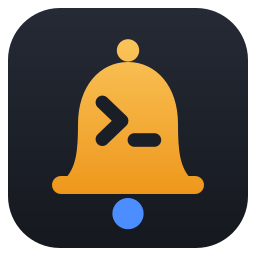
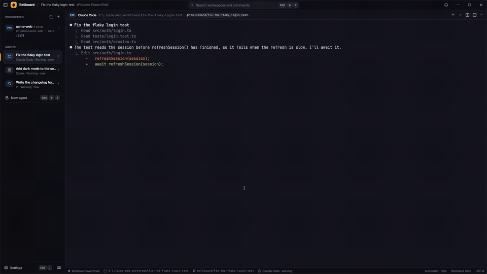
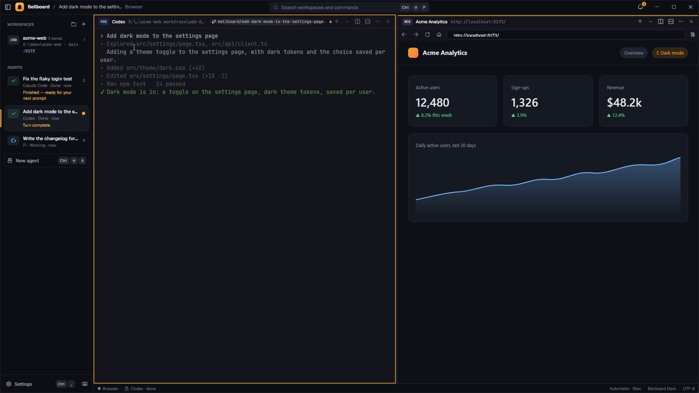

<p align="center"></p>

<h1 align="center">Bellboard</h1>

<p align="center"><b>Run your AI coding agents side by side, on Windows.</b></p>

<p align="center">
  <a href="https://github.com/omer-yld/bellboard/releases/latest"></a>
  <a href="https://github.com/omer-yld/bellboard/actions/workflows/ci.yml"></a>
  
  <a href="LICENSE"></a>
</p>

<p align="center"></p>

Bellboard is a native Windows terminal built for running many AI coding agents at once: Claude Code,
Codex, OpenCode and Pi. Each agent gets its own git branch and worktree, the sidebar shows who's
working and who needs you, and a pulsing ring brings you to the right terminal. Agents can drive it
too, through a CLI, a pipe API and an MCP server.

It brings the idea of [cmux](https://cmux.com) (macOS) to Windows, with WSL, PowerShell and SSH as
first-class citizens. Free and open source (MIT). No account, no telemetry.

## Quick start

1. Download `bellboard-<version>-win-x64.zip` from [Releases](https://github.com/omer-yld/bellboard/releases/latest),
   unzip it, and run `install.ps1` (per user, no admin, no .NET install needed).
2. Start **Bellboard** from the Start menu.
3. Let your agents report their status (working, needs you, done):
   ```powershell
   bell hooks install          # Claude Code hooks, Codex notify, a Pi extension
   bell hooks install --wsl    # the same for agents installed inside WSL
   ```
4. Press `Ctrl+Shift+A` for **New agent**: pick a repo, write the task, choose the agent. It starts on
   its own branch in its own worktree, and its card appears in the sidebar.

The builds aren't code-signed yet, so Windows SmartScreen may say *"Windows protected your PC"*: choose
**More info › Run anyway**, or build it yourself (below). Each release lists its SHA-256 checksums.

## What you get

| | |
|---|---|
| **Agents** | `bell agent new "<task>"` gives each agent its own git worktree and branch. Claude Code, Codex, OpenCode and Pi are built in, with status hooks, subagent tracking and session resume after a restart. **Finish agent** merges, opens a pull request, keeps or discards the branch. |
| **Attention** | Pulsing rings, unread badges, an inbox of who needs you and for how long, a taskbar flash, and Windows notifications with **Jump** and **Mark read**. Do not disturb and per-workspace mute. |
| **Workspaces** | A sidebar with a shell badge per workspace (WSL, PS, CMD, GIT, SSH), its folder and branch, listening ports, agent state, status pills, progress and the latest log line. Drag to reorder, pin the ones you keep, hide the sidebar with `Ctrl+Shift+B`, and reopen what you closed with `Ctrl+Shift+Z`. |
| **Splits and tabs** | Nested splits, tabs in any pane, zoom and equalize. Drag a tab or a pane's header onto another pane's edge to split it, onto its tabs to join them, or onto a workspace to move it there; shells keep running. Flip a split between side by side and top and bottom. Tabs shrink to fit, the rest wait behind a `+N` list, and pinned tabs never close by accident. |
| **Shells** | PowerShell 7, Windows PowerShell, cmd, Git Bash, WSL distros (bash and zsh) and SSH hosts, with automatic folder and git-branch tracking. New tabs open in the shell you're in, including a `wsl` or `ssh` you started at a prompt. Your Windows Terminal font, theme and Nerd Font icons work. |
| **Browser** | A real Chromium (WebView2) pane whose start page lists your dev servers. Agents can snapshot, click, type, evaluate, take screenshots and read the console and network logs. |
| **For agents** | A CLI (`bell`), a named-pipe JSON API, and an MCP server (`bell mcp`, 24 tools) so an agent can open splits, read and type in terminals, report status and drive the browser. |
| **Fast and native** | .NET 9 and WPF, ConPTY with a bundled OpenConsole, and a GPU (WebGL) xterm.js renderer. No Electron. A new workspace shows its prompt in about 35 ms; idle workspaces free their renderers while their shells keep running. |



## Agents

```powershell
bell agent new "fix the flaky login test"              # branch bellboard/fix-the-flaky-login-test + worktree + workspace + claude
bell agent new "write the changelog" --agent codex
bell agent new "add retries to the client" --agent pi
bell inbox                                              # who needs input, and for how long
bell agent finish --merge | --pr | --keep | --discard
```

- **Isolation:** each agent works in `<repo>.worktrees/<task>` on its own branch, so parallel agents
  never touch each other's files. (Agents still run with your rights: worktrees separate files, not
  permissions.)
- **Where it runs:** where the repo is. In a Windows folder, the agent uses Windows git and the agent on
  your PATH. In a WSL folder (`\\wsl.localhost\…`), the worktree, git, `gh` and the agent all run inside
  that distro. The **New agent** dialog shows which.
- **Finishing:** merges into the base branch only into a clean checkout and stops on conflicts, opens a
  pull request with `gh`, or discards the branch after asking about unmerged commits.
- **Status from anything:** scripts can report to their workspace card.

```powershell
bell status set tests "running" --color blue
bell progress 0.4 --label "migrating"
bell log --level success "all 128 tests passed"
bell notify --title "Build" "Release build finished"
```

Programs can also notify with an escape sequence: OSC 9 (iTerm2), OSC 99 (kitty) or OSC 777
(Ghostty, rxvt).

**Feeds** show work that happens elsewhere: a read-only workspace that another program (a build
server, another assistant) writes into, with its state on the sidebar and in the inbox.

```powershell
$p = bell feed open "Nightly build" --badge CI --label "Build server"
bell feed status --pane $p working "compiling"
bell feed write --pane $p "step 3/7: tests"
bell feed status --pane $p done "all green"
```

## Shells

New tabs, splits and workspaces open in the same shell and folder as the pane you're in. To pick another
one, press `Ctrl+Shift+Space` (or the **⌄** next to a tab row's **+**): your installed shells, each WSL
distro, the hosts in `~/.ssh/config`, and **Connect to a host…**. Settings › Shell sets the default.

- From scripts: `bell new --shell wsl:Ubuntu`, `bell tab new --shell ssh:devbox`, `bell split right --shell cmd`.
- In WSL panes `bell` works as on Windows, so agents and scripts inside Linux can call it too.
- SSH uses Windows' OpenSSH client, so your keys, `ssh-agent` and `~/.ssh/config` work as usual.

## Keyboard

`Ctrl+Shift+P` opens the **command palette**, which reaches everything below. On layouts where AltGr is
Ctrl+Alt (Turkish, German, …), only the arrow keys use Ctrl+Alt, so typing is never swallowed.

| Shortcut | Action |
|---|---|
| `Ctrl+Shift+A` | New agent |
| `Ctrl+Shift+T` · `Ctrl+Shift+N` | New workspace · new tab, both in the current shell and folder |
| `Ctrl+Shift+Space` | New tab with another shell: PowerShell, cmd, Git Bash, WSL or SSH |
| `Ctrl+Shift+D` / `E` | Split right / down |
| `Ctrl+Shift+W` · `Ctrl+Shift+Z` | Close tab or pane · reopen the last closed |
| `Ctrl+Shift+[` / `]` · `Ctrl+1…9` · `Ctrl+Tab` | Previous / next tab · workspace N · next workspace |
| `Ctrl+Alt+Arrows` · `Ctrl+Shift+Alt+Arrows` | Focus the pane in that direction · resize |
| `Ctrl+Shift+Enter` · `Ctrl+Shift+=` | Zoom the pane · equalize splits |
| `Ctrl+Shift+I` · `Ctrl+Shift+U` | Inbox · jump to the latest unread |
| `Ctrl+Shift+F` · `Ctrl+Shift+L` | Find in terminal · open the browser |
| `Ctrl+Shift+R` · `Ctrl+Shift+B` · `Ctrl+,` | Rename the workspace · toggle the sidebar · settings |

## CLI, API and MCP

Inside a pane, commands target that pane (`BELLBOARD_PANE_ID`); elsewhere, the focused one. Use
`--pane p3` or `--workspace 2` to aim and `--json` for machine-readable output. `bell help` lists
everything.

```powershell
bell list                                   # workspaces → panes, tabs, cwd, branch, ports, status
bell new --name api --cwd C:\code\api --cmd "npm run dev"
bell split right --shell wsl:Ubuntu
bell tab new --browser localhost:5173
bell move-pane p2 down --pane p5            # rearrange; the shell keeps running
bell send --pane p2 --enter "git status"
bell read --pane p2 --lines 40
bell browser open localhost:5173; bell browser snapshot; bell browser click e3

bell mcp install                            # register the MCP server with Claude Code
bell skill install                          # a Claude Code skill that teaches agents to use Bellboard
```

The named pipe `\\.\pipe\bellboard-<user>` accepts only your Windows user and speaks newline-delimited
JSON: `{"id":1,"method":"pane.split","params":{"direction":"right"}}`. The methods are in
[`CommandRouter.cs`](src/Bellboard.App/Ipc/CommandRouter.cs).

## Privacy and safety

- **No telemetry, no account.** Bellboard makes no network requests of its own. The browser pane loads
  what you open; `bell update` checks GitHub's latest release only when you run it.
- **Only you can drive it.** The pipe and the CLI accept your Windows user only. Anything running as
  you can type into your terminals, as with any terminal you can script.
- **Agents run with your rights.** Bellboard organizes agents; it doesn't sandbox them.

## Install from source

```powershell
.\build.ps1 -Install          # needs the .NET 9 SDK; installs to %LOCALAPPDATA%\Programs\Bellboard
.\build.ps1 -Test -Smoke      # unit tests, build, end-to-end smoke test in an isolated instance
.\build.ps1 -Package          # self-contained zip + SHA-256 + update feed + winget manifests
```

`install.ps1` adds `bell` to your PATH, creates a Start menu entry and registers Bellboard in
*Settings › Apps*, where Uninstall works. Every step is optional (`-NoPath`, `-NoShortcut`,
`-NoRegister`, `-InstallDir`). `bell doctor --zip` collects what a bug report needs.

**Requirements:** Windows 10 1809 or later, or Windows 11 (x64), and the WebView2 Runtime (already on
Windows 11).

## Configuration

Use **Settings** (`Ctrl+,`) or edit `%APPDATA%\Bellboard\config.json`; changes apply live.

| Key | Default | |
|---|---|---|
| `shell` | PowerShell 7 if installed | `pwsh`, `powershell`, `cmd`, `bash`, `wsl`, `wsl:<distro>` or a command line |
| `fontFamily`, `fontSize`, `lineHeight` | automatic, 14, 1.12 | Automatic = Windows Terminal's font plus a Nerd Font for icons |
| `theme`, `themeName` | Bellboard Dark | Presets and your Windows Terminal schemes are in Settings |
| `newWorkspaceDirectory` | `inherit` | `inherit`, `home` or a path |
| `restoreSession`, `restoreAgents` | `true` | Restore layout and scrollback; resume Claude Code, Codex, OpenCode and Pi sessions |
| `unloadIdleWorkspacesMinutes` | 30 | Free the renderers of workspaces hidden this long (0 = never) |
| `updateFeed` | none | A `latest.json` URL to get an in-app notice when an update is out |

Logs, the session and browser data live in `%LOCALAPPDATA%\Bellboard\`. `Bellboard.exe --fresh` starts
without restoring. To run a test instance beside your real one, set `BELLBOARD_PIPE` and
`BELLBOARD_HOME`.

## FAQ

**Why not Windows Terminal?** It's an excellent terminal, but it doesn't know about agents: no worktree
per task, no "who needs me" inbox, no API for agents to drive it.

**Is this cmux for Windows?** Same idea, separate project. cmux is a native macOS app and has no
Windows build. Bellboard isn't affiliated with cmux or Manaflow.

| cmux (macOS) | Bellboard (Windows) |
|---|---|
| Swift + AppKit, libghostty (Metal) | C# + WPF, xterm.js WebGL in WebView2 |
| Unix socket + CLI | Named pipe (current user only) + CLI + MCP server |
| WebKit browser pane | WebView2 (Chromium) pane scripted over CDP |
| macOS notifications | Windows notifications with actions, taskbar badge, inbox |

**macOS or Linux?** No. Bellboard is Windows-only by design; on Linux and macOS, tmux and cmux exist.

**Claude Code's teammate split panes?** They need tmux or iTerm2, which Windows doesn't have. Bellboard
shows subagents and teammates on the agent's card and in the inbox instead.

## Contributing

Bug reports, ideas and pull requests are welcome: see [CONTRIBUTING.md](CONTRIBUTING.md). Security issues:
[SECURITY.md](SECURITY.md). What's planned: [docs/ROADMAP.md](docs/ROADMAP.md).

## License

[MIT](LICENSE). Bundled third-party code (xterm.js, Microsoft's ConPTY and WebView2 SDK, the Geist and
JetBrains Mono fonts) is listed with its licenses in [THIRD_PARTY_NOTICES.md](THIRD_PARTY_NOTICES.md).
